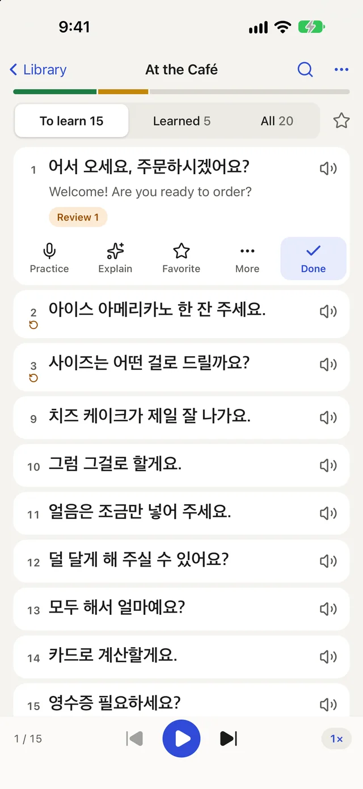
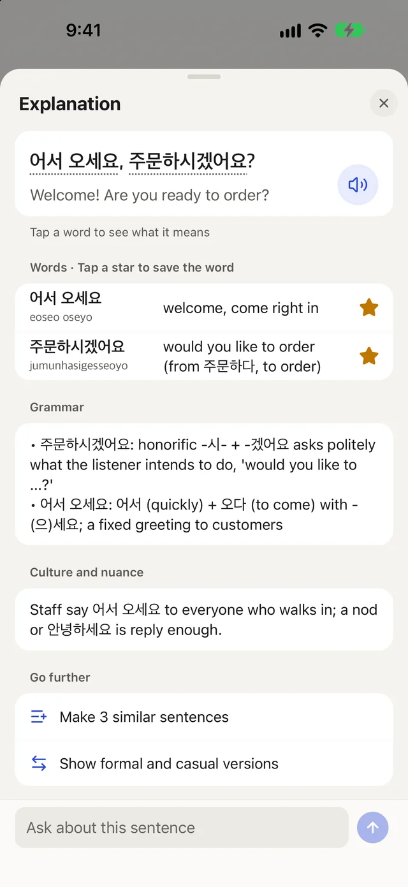
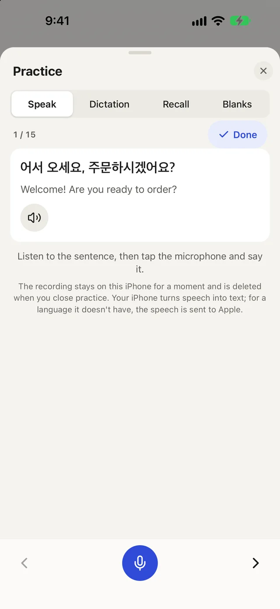

<section class="hero">
  

    

      <h1>The lines you learn become the things you say.</h1>
      
Listen to a script you love, say it out loud, and meet each sentence again just before you forget it. iScript is an iPhone app for learning a language from scripts.

      

        <a class="button" href="https://apps.apple.com/us/app/iscript/id6758364468" target="_blank" rel="noopener">Download on the App Store</a>
        <a class="text-link" href="/resources-en/">See sample scripts</a>
      

      <ul class="facts">
        <li>Free</li>
        <li>No account</li>
        <li>iPhone · iPad</li>
        <li>English · Japanese · Chinese · Portuguese · Korean</li>
      </ul>
    

    <figure class="phone">
      
    </figure>
  

</section>

<section class="steps" aria-label="How it works">
  

    

      01
      <h3>Bring it in</h3>
      
Lines from a drama, lecture subtitles, sentences you wrote. Paste them or import a file.

    

    

      02
      <h3>Listen and speak</h3>
      
One sentence at a time: listen, say it, write it down, recall it with the text hidden.

    

    

      03
      <h3>Meet it again</h3>
      
A sentence you know comes back about when you would forget it. A few minutes a day.

    

  

</section>

<section class="feature">
  

    <figure class="phone">
      
    </figure>
    

      <h2>A sentence you don't get is explained right there.</h2>
      
What the words mean, the grammar, and when people say it. Words you pick from an explanation go to your word list.

      
How AI explanations work depends on your device. <a href="/api-en/">AI setup</a>

    

  

</section>

<section class="feature flip">
  

    <figure class="phone">
      
    </figure>
    

      <h2>Say it out loud, and see how close you were.</h2>
      
Repeat a sentence and the app shows how much of it matched. Dictation, recall and fill-in-the-blank practice are in the same place.

      
Your scripts and study records stay on your iPhone.

    

  

</section>

<section class="closing">
  

    <h2>One line today is enough.</h2>
    <a class="button button-light" href="https://apps.apple.com/us/app/iscript/id6758364468" target="_blank" rel="noopener">Download on the App Store</a>
  

</section>
