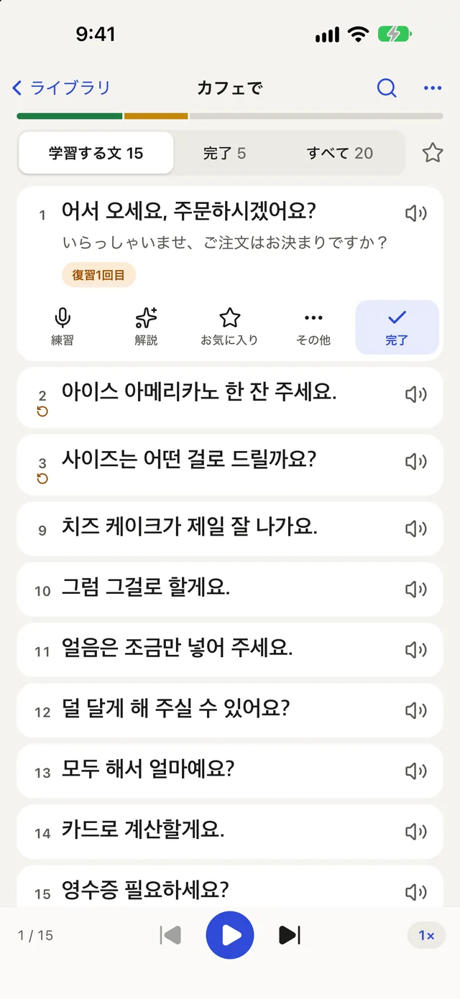
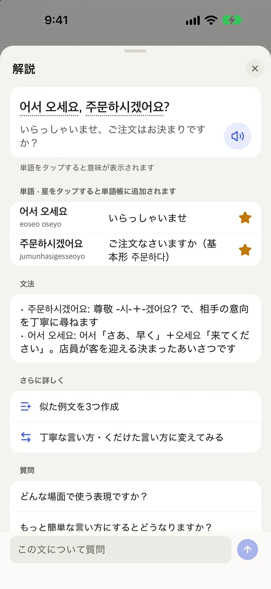
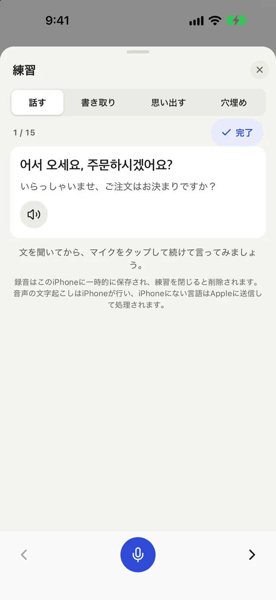

<section class="hero">
  

    

      <h1>覚えた一文が、 自分の言葉になる。</h1>
      
好きなスクリプトを聞いて、声に出して、忘れかけた頃にその文ともう一度出会います。iScriptは、スクリプトで外国語を学ぶiPhoneアプリです。

      

        <a class="button" href="https://apps.apple.com/jp/app/iscript/id6758364468" target="_blank" rel="noopener">App Storeからダウンロード</a>
        <a class="text-link" href="/resources-ja/">サンプルスクリプトを見る</a>
      

      <ul class="facts">
        <li>無料</li>
        <li>アカウント不要</li>
        <li>iPhone · iPad</li>
        <li>英語 · 日本語 · 中国語 · ポルトガル語 · 韓国語</li>
      </ul>
    

    <figure class="phone">
      
    </figure>
  

</section>

<section class="steps" aria-label="学習の流れ">
  

    

      01
      <h3>読み込む</h3>
      
ドラマのセリフ、講義の字幕、自分で書いた文。ペーストするか、ファイルから読み込みます。

    

    

      02
      <h3>聞いて話す</h3>
      
一文ずつ聞いて、まねして話し、書き取り、文を隠して思い出します。

    

    

      03
      <h3>また出会う</h3>
      
覚えた文は、忘れかけた頃にまた出てきます。1日数分で十分です。

    

  

</section>

<section class="feature">
  

    <figure class="phone">
      
    </figure>
    

      <h2>わからない文は、 その場で解説します。</h2>
      
単語の意味、文法、その表現が使われる場面まで。解説で選んだ単語は単語帳に集まります。

      
Apple Intelligenceに対応したiPhoneでは、キーは不要です。 <a href="/api-ja/">AI設定を見る</a>

    

  

</section>

<section class="feature flip">
  

    <figure class="phone">
      
    </figure>
    

      <h2>声に出して言ってみて、 すぐに確認します。</h2>
      
文をまねして話すと、どのくらい合っていたかが表示されます。書き取り、思い出す、穴埋めの練習も同じ場所でできます。

      
スクリプトと学習記録は、自分のiPhoneにだけ保存されます。

    

  

</section>

<section class="closing">
  

    <h2>今日は一文で十分です。</h2>
    <a class="button button-light" href="https://apps.apple.com/jp/app/iscript/id6758364468" target="_blank" rel="noopener">App Storeからダウンロード</a>
  

</section>
