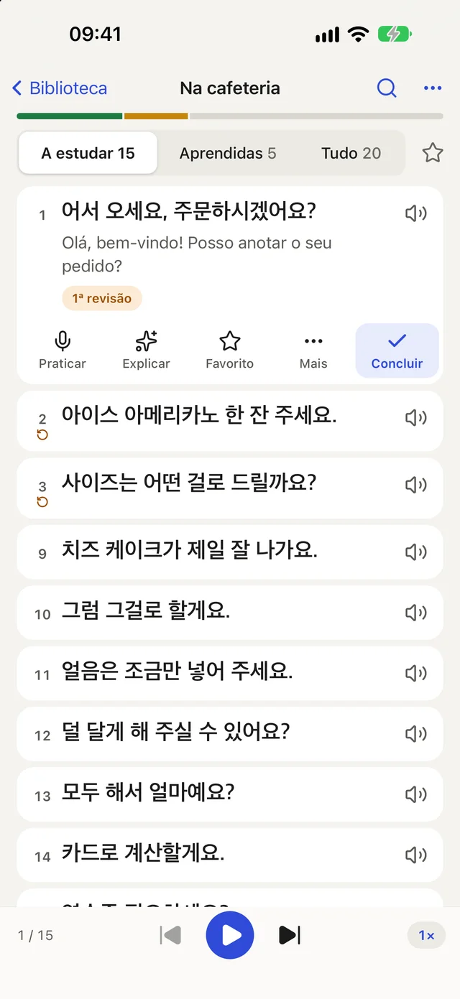
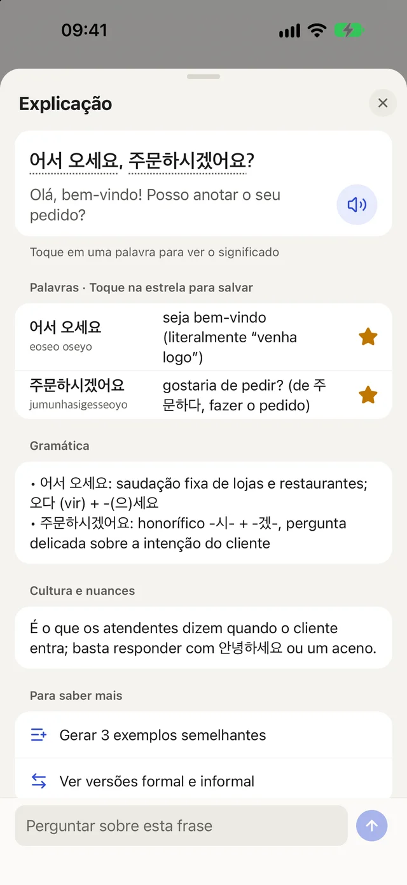
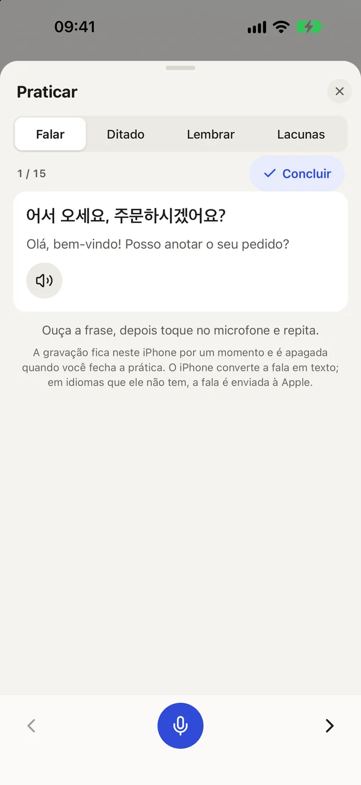

<section class="hero">
  

    

      <h1>As frases que você aprende se tornam o que você diz.</h1>
      
Ouça um roteiro de que você gosta, repita em voz alta e reveja cada frase pouco antes de esquecê-la. O iScript é um app de iPhone para aprender idiomas com roteiros.

      

        <a class="button" href="https://apps.apple.com/br/app/iscript/id6758364468?pt=128486718&amp;ct=home&amp;mt=8" target="_blank" rel="noopener">Baixar na App Store</a>
        <a class="text-link" href="/resources-pt-br/">Ver roteiros de exemplo</a>
      

      <ul class="facts">
        <li>Gratuito</li>
        <li>Sem conta</li>
        <li>iPhone · iPad</li>
        <li>Inglês · Japonês · Chinês · Português · Coreano</li>
      </ul>
    

    <figure class="phone">
      
    </figure>
  

</section>

<section class="steps" aria-label="Como funciona">
  

    

      01
      <h3>Importe</h3>
      
Falas de uma série, legendas de uma aula, frases que você escreveu. Cole o texto ou importe um arquivo.

    

    

      02
      <h3>Ouça e fale</h3>
      
Uma frase por vez: ouça, repita, escreva o que ouviu e lembre com o texto oculto.

    

    

      03
      <h3>Reveja</h3>
      
Uma frase que você já aprendeu volta mais ou menos quando você a esqueceria. Bastam alguns minutos por dia.

    

  

</section>

<section class="feature">
  

    <figure class="phone">
      
    </figure>
    

      <h2>A frase que você não entende é explicada ali mesmo.</h2>
      
O significado das palavras, a gramática e as situações em que a frase é usada. As palavras que você escolhe em uma explicação ficam salvas no vocabulário.

      
A forma de usar as explicações com IA depende do aparelho. <a href="/api-pt-br/">Configuração de IA</a>

    

  

</section>

<section class="feature flip">
  

    <figure class="phone">
      
    </figure>
    

      <h2>Fale em voz alta e confira na hora.</h2>
      
Repita uma frase e o app mostra o quanto você acertou. As práticas de ditado, de lembrar a frase e de preencher lacunas ficam no mesmo lugar.

      
Seus roteiros e seu histórico de estudo ficam salvos apenas no seu iPhone.

    

  

</section>

<section class="closing">
  

    <h2>Uma frase hoje já basta.</h2>
    <a class="button button-light" href="https://apps.apple.com/br/app/iscript/id6758364468?pt=128486718&amp;ct=home&amp;mt=8" target="_blank" rel="noopener">Baixar na App Store</a>
  

</section>
