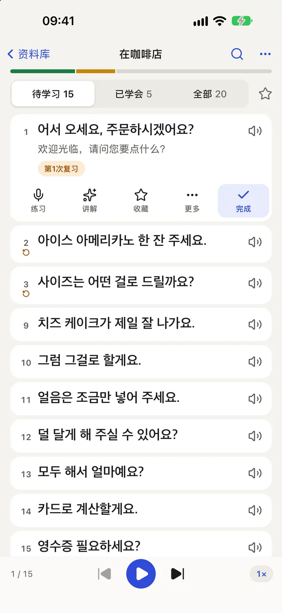
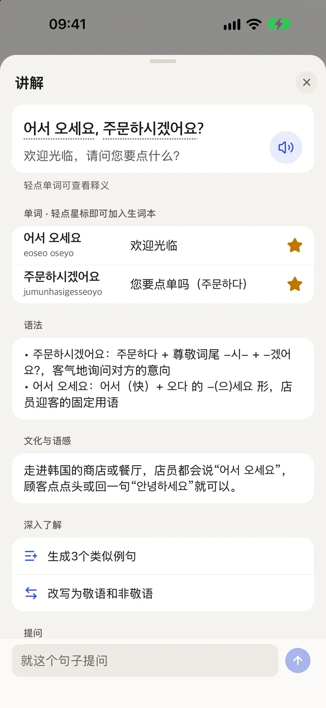
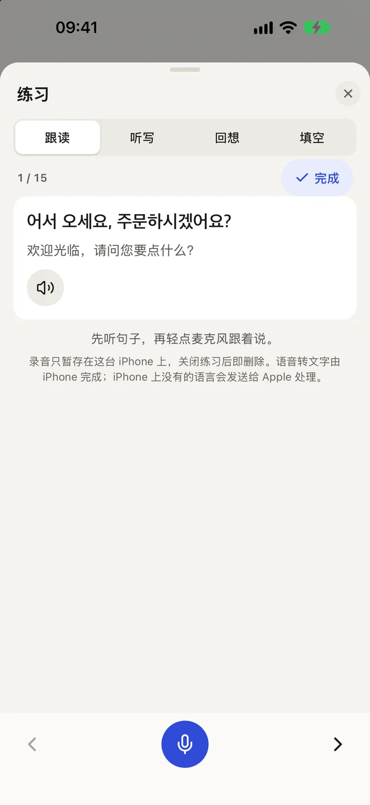

<section class="hero">
  

    

      <h1>背过的句子， 变成自己的话。</h1>
      
听喜欢的脚本，跟着说出来，在快要忘记时再看一遍。iScript 是一款用脚本学外语的 iPhone App。

      

        <a class="button" href="https://apps.apple.com/cn/app/iscript/id6758364468" target="_blank" rel="noopener">在 App Store 下载</a>
        <a class="text-link" href="/resources-zh/">查看示例脚本</a>
      

      <ul class="facts">
        <li>免费</li>
        <li>无需注册</li>
        <li>iPhone · iPad</li>
        <li>英语 · 日语 · 中文 · 葡萄牙语 · 韩语</li>
      </ul>
    

    <figure class="phone">
      
    </figure>
  

</section>

<section class="steps" aria-label="学习步骤">
  

    

      01
      <h3>导入</h3>
      
电视剧的台词、课程的字幕、自己写的句子。粘贴进来，或从文件导入。

    

    

      02
      <h3>听和说</h3>
      
一次一句：听，跟着说，写下来，再遮住文字回想。

    

    

      03
      <h3>再次遇见</h3>
      
学会的句子会在快要忘记时再次出现。每天几分钟就够了。

    

  

</section>

<section class="feature">
  

    <figure class="phone">
      
    </figure>
    

      <h2>看不懂的句子， 当场为你讲解。</h2>
      
单词的意思、语法，还有这句话用在什么场合。在讲解中选的单词会收进生词本。

      
AI 讲解的使用方式因设备而异。<a href="/api-zh/">查看 AI 设置</a>

    

  

</section>

<section class="feature flip">
  

    <figure class="phone">
      
    </figure>
    

      <h2>开口说出来， 马上看看说对了多少。</h2>
      
跟着说完一句，App 会显示匹配度。听写、回想和填空练习也在同一处。

      
脚本和学习记录只保存在你的 iPhone 上。

    

  

</section>

<section class="closing">
  

    <h2>今天一句就够了。</h2>
    <a class="button button-light" href="https://apps.apple.com/cn/app/iscript/id6758364468" target="_blank" rel="noopener">在 App Store 下载</a>
  

</section>
