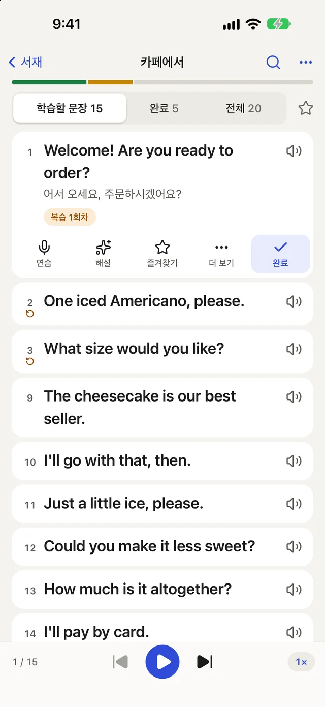
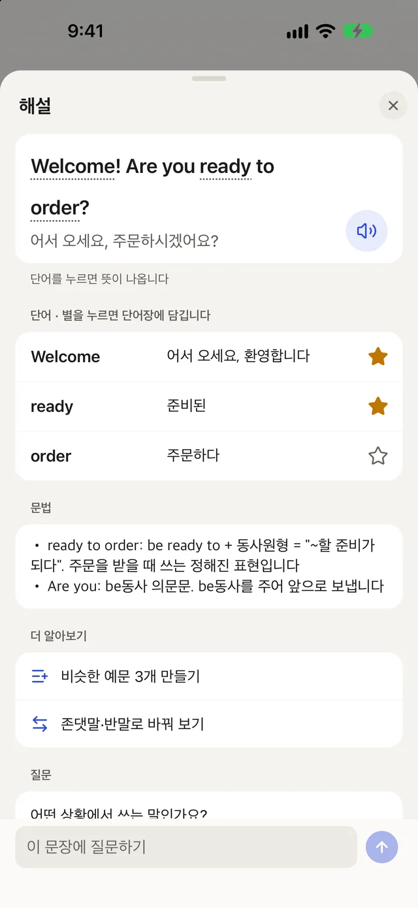
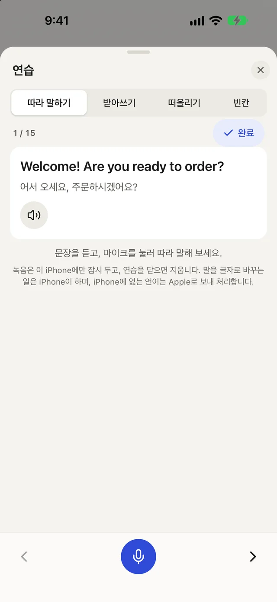

<section class="hero">
  

    

      <h1>외운 문장이, 내 말이 되는 순간.</h1>
      
좋아하는 대본으로 듣고, 따라 말하고, 잊을 때쯤 다시 봅니다. 대본으로 외국어를 공부하는 iPhone 앱입니다.

      

        <a class="button" href="https://apps.apple.com/kr/app/iscript/id6758364468?pt=128486718&amp;ct=home&amp;mt=8" target="_blank" rel="noopener">App Store에서 받기</a>
        <a class="text-link" href="/resources/">샘플 대본 보기</a>
      

      <ul class="facts">
        <li>무료</li>
        <li>가입 없이 바로</li>
        <li>iPhone · iPad</li>
        <li>영어 · 일본어 · 중국어 · 포르투갈어 · 한국어</li>
      </ul>
    

    <figure class="phone">
      
    </figure>
  

</section>

<section class="steps" aria-label="공부하는 순서">
  

    

      01
      <h3>가져오기</h3>
      
드라마 대사, 강의 자막, 직접 쓴 문장. 붙여 넣거나 파일로 가져옵니다.

    

    

      02
      <h3>듣고 말하기</h3>
      
한 문장씩 듣고, 따라 말하고, 받아쓰고, 가린 채 떠올립니다.

    

    

      03
      <h3>다시 만나기</h3>
      
익힌 문장은 잊을 때쯤 다시 나옵니다. 하루 몇 분이면 됩니다.

    

  

</section>

<section class="feature">
  

    <figure class="phone">
      
    </figure>
    

      <h2>모르는 문장은 그 자리에서 풀어 줍니다.</h2>
      
단어의 뜻, 문법, 그 말이 쓰이는 상황까지. 해설에서 고른 단어는 단어장에 모입니다.

      
AI 해설을 쓰는 방법은 기기에 따라 다릅니다. <a href="/api/">AI 설정 보기</a>

    

  

</section>

<section class="feature flip">
  

    <figure class="phone">
      
    </figure>
    

      <h2>소리 내어 말해 보고, 바로 확인합니다.</h2>
      
따라 말하면 얼마나 맞았는지 보입니다. 받아쓰기, 떠올리기, 빈칸 연습도 같은 자리에서 합니다.

      
대본과 학습 기록은 내 iPhone에만 저장됩니다.

    

  

</section>

<section class="closing">
  

    <h2>오늘 한 줄이면 충분해요.</h2>
    <a class="button button-light" href="https://apps.apple.com/kr/app/iscript/id6758364468?pt=128486718&amp;ct=home&amp;mt=8" target="_blank" rel="noopener">App Store에서 받기</a>
  

</section>
